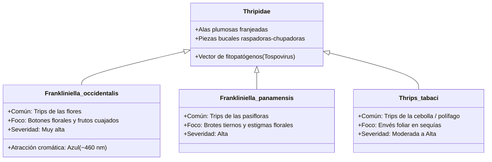

# 🌿 Manejo Agronómico MIP & Ciclo Térmico de Trips en Gulupa

Este documento constituye la guía técnica oficial agronómica implementada en el motor de decisiones de **Macollo Trips API** para el cultivo comercial de **Gulupa (*Passiflora edulis f. edulis*)**, con especial atención a la exportación de fruta fresca hacia mercados exigentes como la Unión Europea (normas GlobalG.A.P.).

---

## 1. Especies Clave de Trips en Pasifloráceas

Los trips (*Insecta: Thysanoptera: Thripidae*) son insectos diminutos de cuerpo esbelto con piezas bucales asimétricas raspadoras-chupadoras. En cultivos de Gulupa en los Andes colombianos y zonas tropicales de altura (1.600 - 2.400 m.s.n.m.), las especies de mayor impacto económico son:

---

## 2. Daño Fitosanitario e Impacto en Exportación

### 2.1 El Fenómeno del "Cacarizado" o "Roña" en Frutos Tiernos
El daño más devastador no ocurre en la hoja, sino en la **floración y los primeros estadios del fruto cuajado**:

1. **Fruto en Cuaje (< 3 cm de diámetro)**: Las larvas raspan vorazmente las células epidérmicas tiernas para succionar los jugos celulares.
2. **Cicatrización Hipertrófica (Suberificación)**: A medida que el fruto crece y acumula masa celular, las zonas raspadas no se expanden elásticamente; la corteza reacciona produciendo una capa corchosa parda y rugosa conocida como **cacarizado**, **roña** o **escama**.
3. **Rechazo Comercial GlobalG.A.P.**: Frutos con más de $1\text{ cm}^2$ de lesión corchosa o con deformaciones asimétricas quedan excluidos de la venta en fresco para supermercados europeos, viéndose relegados a la agroindustria de pulpa con pérdidas de precio de hasta un 65% a 80%.

### 2.2 Caída de Botones Florales y Flores
La oviposición de las hembras adultas dentro del ovario y los sépalos provoca la abscisión prematura de los botones florales, reduciendo drásticamente el cuajado potencial de la plantación.

---

## 3. Modelo Térmico de Grados-Día (Degree-Days)

El desarrollo ontogenético de los insectos poiquilotermos depende directamente de la temperatura acumulada por encima de un umbral fisiológico mínimo o **temperatura base ($T_0$)**.

### 3.1 Parámetros Biofísicos de Frankliniella occidentalis
- **Temperatura Base de Desarrollo ($T_0$)**: $10.5^\circ\text{C}$
- **Requerimientos Térmicos en Grados-Día Acumulados (GDD)**:
  - Fase de Huevo: $60.0 \text{ GDD}$
  - Fase de Larva/Ninfa: $95.0 \text{ GDD}$
  - Fase de Prepupa/Pupa: $55.0 \text{ GDD}$
  - **Ciclo Completo (Huevo a Emergencia de Adulto)**: $\approx 210.0 \text{ GDD}$

### 3.2 Ecuaciones de Proyección
Dada la temperatura media ambiental del invernadero $T$ en grados Celsius:

$$T_{\text{efectiva}} = \max(T - 10.5, \; 1.5)$$

$$\text{Duración en Días} = \frac{\text{GDD Requeridos}}{T_{\text{efectiva}}}$$

### 3.3 Tabla de Duración del Ciclo según Temperatura

| Temp. Invernadero ($^\circ\text{C}$) | Huevo (días) | Larva (días) | Pupa (días) | Total a Adulto (días) | Nivel de Riesgo Fitosanitario |
| :---: | :---: | :---: | :---: | :---: | :--- |
| **$15.0^\circ\text{C}$** | 13.3 | 21.1 | 12.2 | **46.6** | Bajo / Desarrollo lento |
| **$18.0^\circ\text{C}$** | 8.0 | 12.7 | 7.3 | **28.0** | Moderado / Típico noche templada |
| **$20.0^\circ\text{C}$** | 6.3 | 10.0 | 5.8 | **22.1** | Moderado-Alto / Clima ideal Gulupa |
| **$22.0^\circ\text{C}$** | 5.2 | 8.3 | 4.8 | **18.3** | Alto / Alerta en cuaje |
| **$25.0^\circ\text{C}$** | 4.1 | 6.6 | 3.8 | **14.5** | Crítico / Explosión demográfica |
| **$28.0^\circ\text{C}$** | 3.4 | 5.4 | 3.1 | **12.0** | Extremo / Generación cada 12 días |

---

## 4. Protocolo de Manejo Integrado de Plagas (MIP)

Para evitar rechazos por residuos químicos (LMR - Límites Máximos de Residuos) en puertos de destino y prevenir la rápida generación de resistencia genética, se aplica el siguiente programa integrado:

```mermaid
graph TD
    MIP["🌿 Programa MIP en Gulupa de Exportación"]
    
    BIO["1. Control Biológico"]
    ETHO["2. Control Etológico"]
    CULT["3. Control Cultural"]
    CHEM["4. Control Biorracional & Químico"]
    
    MIP --> BIO
    MIP --> ETHO
    MIP --> CULT
    MIP --> CHEM
    
    BIO --> BIO1["Ácaros Depredadores:<br/>Amblyseius swirskii / Neoseiulus cucumeris"]
    BIO --> BIO2["Chinches Depredadoras:<br/>Orius insidiosus (en flores)"]
    BIO --> BIO3["Entomopatógenos:<br/>Beauveria bassiana / Lecanicillium lecanii"]
    BIO --> BIO4["Nematodos de Suelo:<br/>Steinernema feltiae (en plateo contra pupas)"]

    ETHO --> ETH1["Trampas cromotrópicas AZULES (~460 nm)"]
    ETHO --> ETH2["1 trampa / 20 m² (monitoreo)<br/>1 trampa / 8 m² (focos y bordes)"]
    ETHO --> ETH3["Umbral de acción: > 1-2 trips / flor"]

    CULT --> CUL1["Poda sanitaria de espalderas y zarcillos"]
    CULT --> CUL2["Erradicación de malezas: Sonchus oleraceus y Bidens pilosa"]
    CULT --> CUL3["Manejo de Humedad Relativa: 65% a 75%"]
    CULT --> CUL4["Mallas anti-insectos 50 mesh en ventanas"]

    CHEM --> CH1["Biorracionales: Jabón potásico + Azadiractina 1%"]
    CHEM --> CH2["Aceites agrícolas: Extracto de canela / naranja"]
    CHEM --> CH3["Rotación estricta IRAC:<br/>IRAC 5 (Spinosad) → IRAC 29 (Flonicamid) → IRAC 6 (Abamectina)"]
```

---

## 5. Matriz de Rotación Obligatoria IRAC

> [!WARNING]
> Los trips son notorios a nivel mundial por desarrollar resistencia cruzada acelerada cuando se repite el mismo modo de acción en dos generaciones consecutivas.

| Ventana de Aplicación | Grupo IRAC | Principio Activo | Modo de Acción | Dosis Comercial de Referencia | Días de Carencia (Gulupa) |
| :--- | :--- | :--- | :--- | :--- | :--- |
| **Ventana 1** | **IRAC 5** (Espinocinas) | Spinosad o Spinetoram | Moduladores alostéricos del receptor nicotínico de acetilcolina (nAChR) | 0.2 a 0.4 cc/L | 3 días |
| **Ventana 2** | **IRAC 29** | Flonicamid | Modulador de órganos cordotonales (detiene la alimentación en 1 hora) | 0.15 a 0.20 g/L | 3 a 5 días |
| **Ventana 3** | **IRAC 6** (Avermectinas) | Abamectina + Aceite mineral | Activadores del canal de cloro regulado por glutamato | 0.5 a 0.75 cc/L + aceite al 0.25% | 7 días |
| **Soporte Frecuente** | **Biorracional** | Jabón potásico + Neem | Disrupción física cuticular y anti-alimentario | 3-5 cc/L + 1.5 cc/L | 0 días (Orgánico) |
