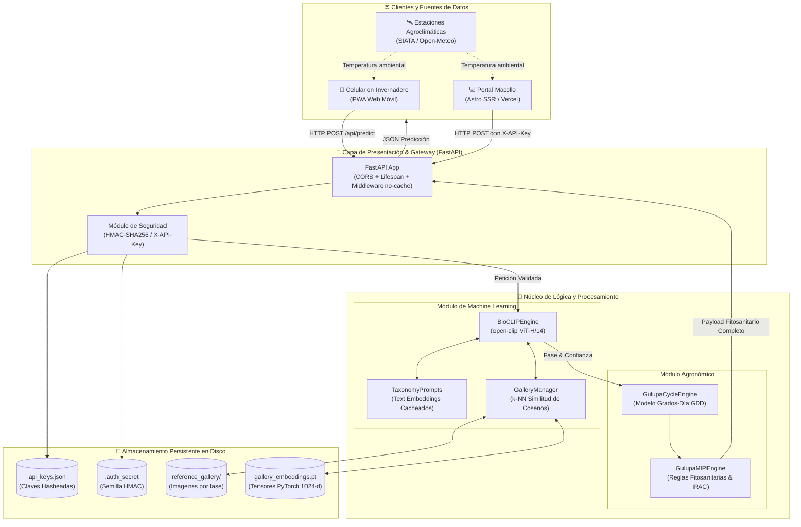
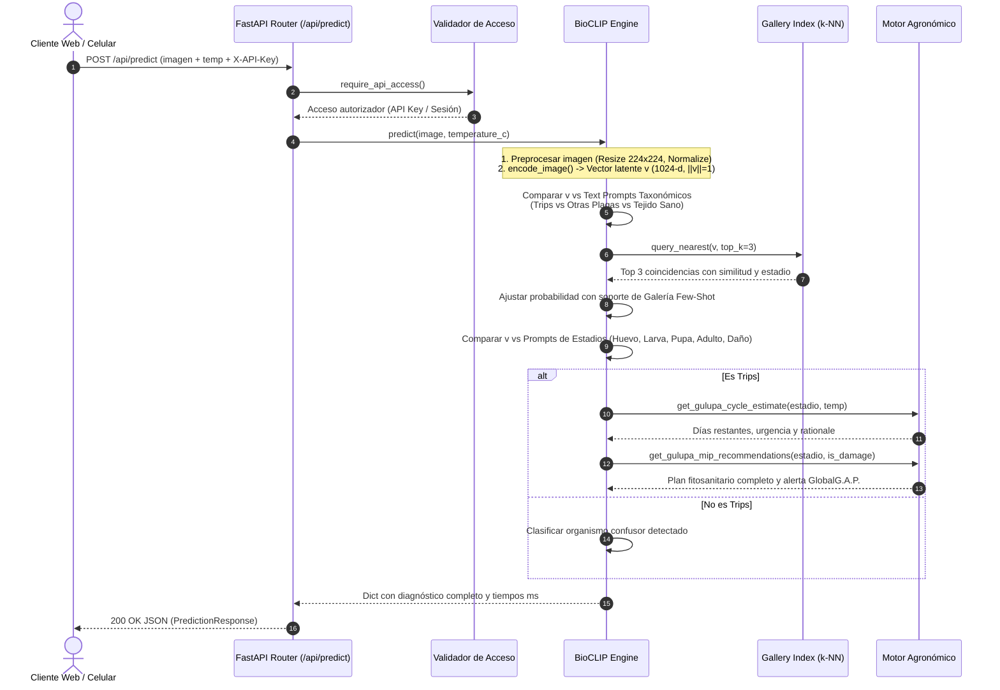

# 🏗️ Arquitectura del Sistema — Trips BioCLIP 2.5 API

Este documento describe la arquitectura de software, el diseño por capas, los componentes de inferencia y la integración de hardware de la **API de Trips BioCLIP 2.5 para Gulupa** (`macollo-trips-api`).

---

## 1. Visión Arquitectónica y Principios de Diseño

El sistema está concebido como un **microservicio de visión artificial y motor de decisiones fitosanitarias de alta especialización**. Actúa de manera desacoplada de la aplicación web principal ([Macollo](https://github.com/VoctorMCL/Macollo)), ofreciendo:

1. **Inferencia Zero-Shot sin Reentrenamiento**: Utiliza un modelo de fundación biológica preentrenado (**BioCLIP 2.5** ViT-H/14) capaz de generalizar sobre especies de insectos a partir de representaciones conjuntas imagen-texto.
2. **Memoria Empírica Local (Few-Shot k-NN)**: Permite que el productor o agrónomo incorpore fotografías tomadas en su propia finca en `data/reference_gallery/`. Estas fotos se proyectan en el espacio latente del modelo y refuerzan la decisión taxonómica mediante similitud de cosenos sin coste computacional de reentrenamiento.
3. **Modelado Biofísico Integrado**: La visión por computador se acopla inmediatamente con un motor agroclimático en grados-día ($T_0=10.5^\circ\text{C}$) y un sistema experto de Manejo Integrado de Plagas (MIP).
4. **Seguridad y Control de Acceso Sin Registro Público**: Doble capa de autenticación con sesiones web firmadas criptográficamente con HMAC-SHA256 para administración y API keys de alta entropía (`mk_...`) almacenadas con hash SHA-256 para clientes externos.

---

## 2. Diagrama de Arquitectura Global

---

## 3. Capas del Sistema

### 3.1 Capa de Entrada y Seguridad (`backend/app/main.py` y `auth.py`)
- **FastAPI**: Servidor asíncrono ASGI de alto rendimiento.
- **Middleware CORS**: Configurable mediante la variable de entorno `CORS_ORIGINS` (por defecto `*` para facilitar integraciones web).
- **Middleware `disable_ui_cache`**: Inyecta encabezados `Cache-Control: no-store, no-cache` sobre assets HTML/CSS/JS para garantizar que los operadores en campo siempre utilicen la versión más reciente del panel.
- **Control de Acceso Dual**:
  - `require_session`: Valida cookies HttpOnly firmadas para las vistas administrativas del panel (`/api/keys`, `/api/gallery`).
  - `require_api_access`: Valida tanto sesiones de panel como encabezados `X-API-Key: mk_...` para los endpoints de consumo externo (`/api/predict`, `/api/gulupa-handbook`).

### 3.2 Capa de Machine Learning (`backend/app/ml/`)
- **`bioclip_engine.py`**:
  - Gestiona el ciclo de vida del modelo `imageomics/bioclip-2.5-vith14` o su fallback `imageomics/bioclip` (ViT-B/16).
  - Al iniciar el servicio, precalcula y normaliza en norma L2 los embeddings de texto correspondientes a todas las hipótesis taxonómicas y fases biológicas.
  - Al recibir una imagen, extrae un vector de características de 1024 dimensiones, evalúa logits mediante producto escalar con escala de temperatura aprendida (`logit_scale`), y calcula la distribución de probabilidad con `softmax`.
- **`taxonomy_prompts.py`**:
  - Define las jerarquías linneanas y descripciones en lenguaje natural que permiten a BioCLIP discriminar insectos Thripidae frente a plagas frecuentes (Hemiptera, Aleyrodidae, Aphididae, Tetranychidae) y hojas/flores sanas.
- **`gallery_index.py`**:
  - Mantiene un índice de tensores en memoria y en disco (`data/gallery_embeddings.pt`).
  - Ejecuta búsquedas $k$-NN con similitud de cosenos para recuperar los ejemplares más cercanos y reforzar la confianza del modelo base.

### 3.3 Capa Agronómica (`backend/app/agronomy/`)
- **`gulupa_cycle.py`**:
  - Implementa el modelo térmico en Grados-Día Acumulados (GDD) con temperatura base $T_0 = 10.5^\circ\text{C}$.
  - Calcula la duración esperada de cada estadio y los días restantes hasta la emergencia de adultos según la temperatura ambiental suministrada por el usuario o las estaciones meteorológicas.
- **`gulupa_mip.py`**:
  - Genera recomendaciones fitosanitarias estructuradas en 5 ejes:
    1. Control Biológico (*Amblyseius swirskii*, *Orius insidiosus*, *Beauveria bassiana*, *Steinernema feltiae*).
    2. Control Etológico (trampas cromotrópicas adhesivas azules ~460 nm).
    3. Control Cultural (poda sanitaria, ventilación, deshierbe de reservorios).
    4. Control Biorracional y Químico (rotación estricta de modos de acción IRAC).
    5. Alerta de Exportación (protección de frutos cuajados < 3 cm para evitar pérdidas de calificación GlobalG.A.P.).

### 3.4 Capa de Esquemas y Serialización (`backend/app/schemas/`)
- **`prediction.py`**: Define los contratos de datos `PredictionResponse`, `CycleInfo`, `AgronomicRecommendations`, `ExemplarMatch`, `GalleryStatusResponse`.
- **`auth.py`**: Define los contratos `LoginRequest`, `ApiKeyCreateRequest`, `ApiKeyPublic`, etc.

---

## 4. Pipeline de Inferencia Detallado

---

## 5. Decisiones Técnicas y de Rendimiento

| Decisión | Justificación |
| :--- | :--- |
| **Uso de BioCLIP 2.5 (`imageomics/bioclip-2.5-vith14`)** | Modelo entrenado específicamente sobre 10 millones de imágenes biológicas con alineación taxonómica jerárquica de iNaturalist. Supera ampliamente a CLIP estándar de OpenAI en discriminación entomológica fina. |
| **Precomputación de Text Embeddings** | Los textos de consulta se tokenizan y proyectan una sola vez al arrancar el servidor (`_precompute_text_embeddings`). En inferencia solo se evalúa la imagen y se realiza multiplicación de matrices en RAM. |
| **Afinidad de hilos en CPU (`torch.set_num_threads`)** | En procesadores modernos multinúcleo (como Intel Core i9 o AMD Ryzen), se limita a un máximo de 8 hilos para evitar saturación de conmutación de contexto y mantener tiempos de respuesta entre 300 ms y 700 ms. |
| **Few-Shot k-NN sin Reentrenamiento** | Reentrenar un Vision Transformer de tamaño Huge (ViT-H) requiere semanas de cómputo en clústeres GPU. La indexación vectorial de fotos reales del predio permite personalización instantánea manteniendo la estabilidad del modelo. |
| **Autenticación sin Base de Datos Externa** | Para simplificar la operación en campo o en servidores locales de invernadero, las credenciales del panel se configuran en entorno, las sesiones se firman simétricamente y las API keys se almacenan cifradas en JSON con permisos 0600. |
