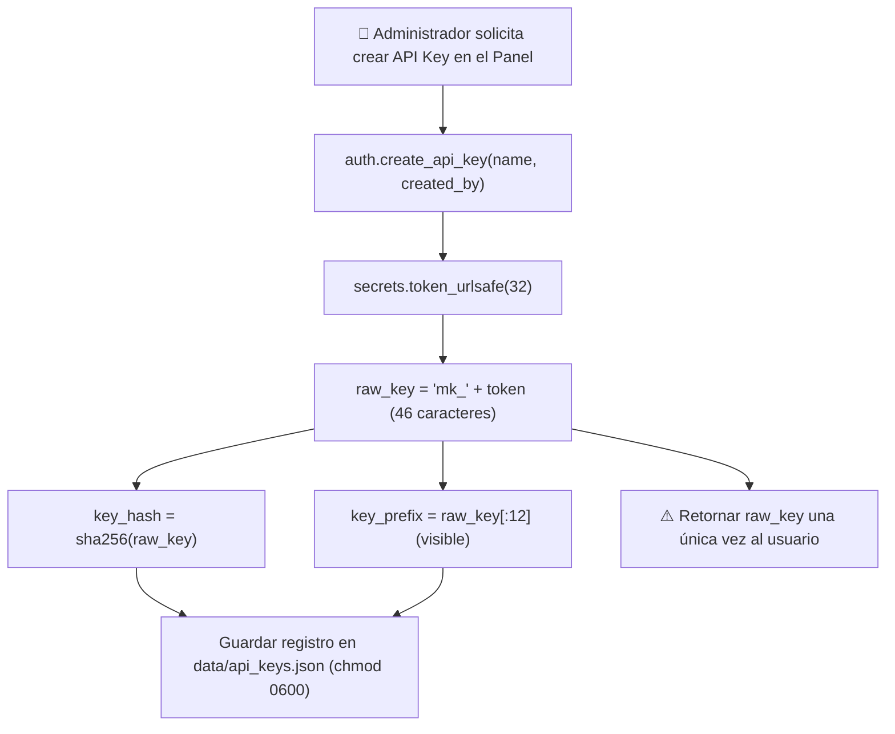

# 🔐 Autenticación & Seguridad — Trips BioCLIP 2.5 API

Este documento detalla la arquitectura de seguridad, la emisión y validación de tokens criptográficos, el almacenamiento de claves API y las directrices de endurecimiento para la operación del microservicio.

---

## 1. Visión de Seguridad y Principios

Para evitar vulnerabilidades de inyección, accesos no autorizados en invernaderos y fugas de credenciales en repositorios públicos:

1. **Sin Registro Público**: No existen formularios de autoregistro en la web. El acceso al panel de administración se confiere únicamente a través de credenciales maestras configuradas en las variables de entorno del servidor.
2. **Doble Mecanismo de Autenticación**:
   - **Sesiones Web de Administrador**: Empleadas por el panel visual para la gestión de fotos, reindexación y creación/revocación de claves de acceso.
   - **API Keys Estructuradas (`mk_...`)**: Empleadas por aplicaciones externas (portal web Macollo en Vercel, apps móviles Android/iOS, scripts de campo en Python/Node.js).
3. **Cero Almacenamiento en Texto Plano**: Las API keys se almacenan únicamente como hashes criptográficos irreversibles (SHA-256). Si el archivo de base de datos local `data/api_keys.json` llegara a ser sustraído, ninguna clave podría ser reconstruida.
4. **Firmas HMAC a Prueba de Manipulación**: Los tokens de sesión web viajan en cookies firmadas criptográficamente con HMAC-SHA256 y comparación en tiempo constante (`hmac.compare_digest`).

---

## 2. Matriz de Permisos por Endpoint

| Endpoint | Método | Acceso Requerido | Mecanismo |
| :--- | :---: | :--- | :--- |
| `/api/health` | `GET` | **Público** | Sin autenticación (monitoreo / health checks) |
| `/api/auth/login` | `POST` | **Público** | Valida `ADMIN_USERNAME` y `ADMIN_PASSWORD` |
| `/api/auth/logout` | `POST` | **Público** | Borra cookie de sesión |
| `/api/auth/me` | `GET` | **Sesión requerida** | Cookie `macollo_session` válida |
| `/api/keys` | `GET` | **Sesión requerida** | Solo administradores del panel |
| `/api/keys` | `POST` | **Sesión requerida** | Solo administradores del panel |
| `/api/keys/{key_id}` | `DELETE` | **Sesión requerida** | Solo administradores del panel |
| `/api/gallery` | `GET` | **Sesión requerida** | Solo administradores del panel |
| `/api/gallery/items` | `GET` | **Sesión requerida** | Solo administradores del panel |
| `/api/gallery/upload` | `POST` | **Sesión requerida** | Solo administradores del panel |
| `/api/gallery/reindex`| `POST` | **Sesión requerida** | Solo administradores del panel |
| `/api/predict` | `POST` | **API Key o Sesión** | Encabezado `X-API-Key` o Cookie de sesión |
| `/api/gulupa-handbook`| `GET` | **API Key o Sesión** | Encabezado `X-API-Key` o Cookie de sesión |

---

## 3. Sesiones de Administrador (Cookies Firmadas)

```mermaid
sequenceDiagram
    autonumber
    actor Admin as Administrador Web
    participant Server as Servidor FastAPI
    participant Auth as Motor Criptográfico (auth.py)

    Admin->>Server: POST /api/auth/login {username, password}
    Server->>Auth: authenticate_admin(u, p)
    Note over Auth: Comparación en tiempo constante con hmac.compare_digest()
    
    alt Credenciales Válidas
        Auth->>Auth: create_session_token(username)
        Note over Auth: 1. payload = {"sub": u, "exp": now + 7d}<br/>2. encoded = base64url(payload)<br/>3. signature = hmac_sha256(secret, encoded)<br/>4. token = encoded + "." + base64url(signature)
        Server-->>Admin: 200 OK + Set-Cookie: macollo_session=token;<br/>HttpOnly; SameSite=Lax; Max-Age=604800
    else Credenciales Inválidas
        Server-->>Admin: 401 Unauthorized ("Usuario o contraseña incorrectos")
    end
```

### 3.1 Estructura del Token de Sesión
El token es un compuesto binario serializado en dos segmentos separados por un punto (`.`):

1. **Segmento de Carga Útil (Payload)**: JSON codificado en Base64 URL-safe sin relleno (`=`).
   ```json
   {"sub": "admin", "exp": 1793458800}
   ```
2. **Segmento de Firma Digital**: Firma HMAC-SHA256 calculada sobre el primer segmento empleando la clave secreta maestra.

### 3.2 Clave Secreta Maestra (`AUTH_SECRET_KEY`)
- Si se define la variable de entorno `AUTH_SECRET_KEY`, el sistema utiliza dicho valor directamente.
- Si no se define, el sistema genera automáticamente una secuencia criptográfica de alta entropía de **32 bytes (256 bits)** mediante `secrets.token_bytes(32)` y la persiste en `data/.auth_secret` con permisos `0600` (solo lectura y escritura para el propietario del proceso).

---

## 4. API Keys para Clientes Externos (`X-API-Key`)

Para integrar el portal web de Gulupa ([Macollo Astro](https://github.com/VoctorMCL/Macollo)) o aplicaciones satélites sin compartir contraseñas maestras, el panel permite crear claves dedicadas:



### 4.1 Formato del Registro en Disco (`data/api_keys.json`)
```json
[
  {
    "id": "7b8f9e12a45c6789",
    "name": "Servidor Web Macollo Astro (Vercel)",
    "key_prefix": "mk_aBcDeFgHiJ",
    "key_hash": "2cf24dba5fb0a30e26e83b2ac5b9e29e1b161e5c1fa7425e73043362938b9824",
    "created_at": "2026-10-24T08:30:00Z",
    "created_by": "admin",
    "last_used_at": "2026-10-24T09:42:15Z",
    "active": true
  }
]
```

### 4.2 Proceso de Verificación en Peticiones Externas
Al llegar una solicitud con el encabezado `X-API-Key`:
1. El servidor verifica que el valor inicie con el prefijo obligatorio `mk_`.
2. Calcula su hash SHA-256 en memoria: `h = sha256(raw_key)`.
3. Recorre las claves activas y compara hashes con `hmac.compare_digest` para neutralizar ataques de canal lateral basados en tiempos de respuesta (timing attacks).
4. Si coincide, actualiza la marca temporal `last_used_at` de forma atómica y concede el acceso.

---

## 5. Endurecimiento para Producción

En entornos de producción expuestos a Internet, configure las siguientes variables de entorno:

```bash
# Credenciales maestras del panel
export ADMIN_USERNAME="agronomo_jefe"
export ADMIN_PASSWORD="cambia_esta_clave_por_una_larga_y_segura_2026"

# Secreto de firma de sesión
export AUTH_SECRET_KEY="cadena_aleatoria_super_secreta_de_al_menos_64_caracteres"

# Obligatorio al usar HTTPS (bloquea la cookie sobre HTTP simple)
export SESSION_COOKIE_SECURE="true"

# Orígenes CORS permitidos (restringir a la URL del portal Macollo)
export CORS_ORIGINS="https://macollo.agro.co,https://tu-dominio.vercel.app"
```

> [!IMPORTANT]
> Los navegadores modernos prohíben el acceso a la cámara (`navigator.mediaDevices.getUserMedia`) en conexiones HTTP inseguras no locales. Es mandatorio desplegar la API detrás de un proxy inverso con **HTTPS/TLS** (ver [Despliegue](./DEPLOYMENT.md)).
