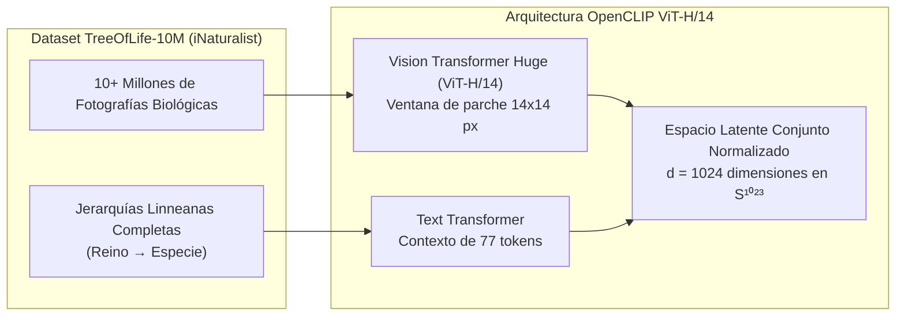
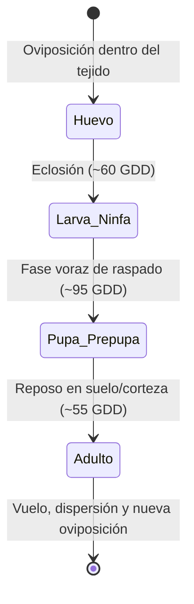
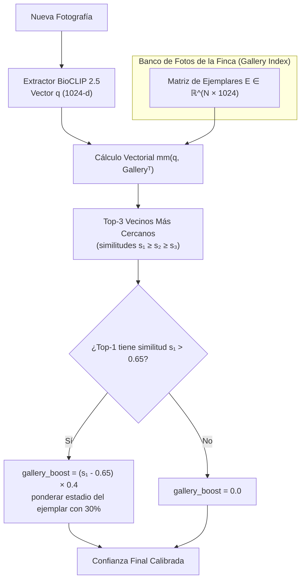

# 🧠 Motor BioCLIP 2.5 & Visión Artificial Entomológica

Este documento detalla la fundamentación de Machine Learning, el diseño de prompts taxonómicos, la arquitectura de tensores y la matemática del ensamble Few-Shot implementados en **Macollo Trips API**.

---

## 1. Fundamentos del Modelo BioCLIP 2.5

El núcleo de visión artificial del sistema se fundamenta en **BioCLIP 2.5** (`imageomics/bioclip-2.5-vith14`), desarrollado por el consorcio **Imageomics** de la National Science Foundation (NSF) y la Universidad de Ohio.

### ¿Por qué BioCLIP 2.5 frente a modelos de visión genéricos?
1. **Alineación Taxonómica Estricta**: A diferencia de CLIP estándar (entrenado con fotos genéricas de Internet donde un insecto es clasificado como "bicho" o "plaga"), BioCLIP fue entrenado forzando la alineación jerárquica linneana: `Animalia Arthropoda Insecta Thysanoptera Thripidae ...`.
2. **Discriminación Morfológica Fina**: Distingue con alta precisión estructuras anatómicas micrométricas: alas franjeadas plumosas de trips, estiletes chupadores, ninfas ápteras vs adultos alados, y lesiones peridérmicas en frutos verdes.
3. **Generalización Zero-Shot Inmediata**: No requiere reentrenar capas densas ni recopilar miles de fotos anotadas con bounding boxes en cada campaña agrícola.
4. **Resistencia a Iluminación de Invernadero**: Mantiene la invariancia frente a sombras, cubiertas de plástico difuso, mallas sombra y condensación foliar.

---

## 2. Espacio Latente y Matemática de la Inferencia

### 2.1 Normalización en la Hiperesfera Unitaria
Tanto la imagen procesada $\mathbf{x}$ como las cadenas de texto $\mathbf{t}_k$ se proyectan en vectores de $d = 1024$ dimensiones y se normalizan con la norma euclidiana $L_2$:

$$\mathbf{v}_{\text{img}} = \frac{f_{\text{vision}}(\mathbf{x})}{\|f_{\text{vision}}(\mathbf{x})\|_2}, \quad \mathbf{v}_{\text{text}, k} = \frac{f_{\text{text}}(\mathbf{t}_k)}{\|f_{\text{text}}(\mathbf{t}_k)\|_2}$$

De esta manera, el producto escalar entre ambos vectores equivale exactamente a su **similitud de cosenos**:

$$\cos(\theta_k) = \mathbf{v}_{\text{img}} \cdot \mathbf{v}_{\text{text}, k}^\top \in [-1, 1]$$

### 2.2 Escalamiento y Distribución de Probabilidad
Para calibrar la agudeza de la distribución categórica, el modelo aplica el parámetro de temperatura aprendido (`logit_scale` $\gamma$, limitado internamente a $\le 100$):

$$z_k = \gamma \cdot (\mathbf{v}_{\text{img}} \cdot \mathbf{v}_{\text{text}, k}^\top)$$

$$P(\text{clase}_k \mid \mathbf{x}) = \frac{\exp(z_k)}{\sum_{j=1}^{K} \exp(z_j)}$$

---

## 3. Ingeniería de Prompts Taxonómicos

Para evitar falsos positivos provocados por la fauna común o artefactos en invernaderos de pasifloras, el motor evalúa simultáneamente un conjunto de **14 hipótesis taxonómicas contrastivas**:

### 3.1 Clases Positivas (Thysanoptera: Thripidae)
| Clave | Descripción Linneana y Contextual |
| :--- | :--- |
| `trips_frankliniella_occidentalis` | `Animalia Arthropoda Insecta Thysanoptera Thripidae Frankliniella occidentalis, western flower thrips on passionfruit leaf or flower` |
| `trips_panamensis` | `Animalia Arthropoda Insecta Thysanoptera Thripidae Frankliniella, flower thrips insect on Passiflora edulis flower bud` |
| `trips_tabaci` | `Animalia Arthropoda Insecta Thysanoptera Thripidae Thrips tabaci, onion thrips slender elongated body on foliage` |
| `trips_general` | `Animalia Arthropoda Insecta Thysanoptera Thripidae, close-up photo of a slender thrips insect pest` |
| `trips_dano_fruto_gulupa` | `Close-up photo of purple passionfruit (gulupa, Passiflora edulis) young green fruit showing severe thrips feeding damage, corky surface scarring, scab, cacarizado or roña` |

### 3.2 Clases Negativas (Plagas Confusoras y Artefactos)
| Clave | Plaga / Objeto | Justificación de Inclusión |
| :--- | :--- | :--- |
| `neg_mosca_blanca` | *Bemisia tabaci* (Hemiptera: Aleyrodidae) | Muy abundante en envés foliar; cuerpo blanco polvoriento con alas cerosas. |
| `neg_pulgon` | *Aphis gossypii* (Hemiptera: Aphididae) | Insecto globular fitófago que causa encrespamiento foliar. |
| `neg_arana_roja` | *Tetranychus urticae* (Trombidiformes) | Ácaro tejedor con punteaduras amarillentas que puede confundirse en monitoreo rápido. |
| `neg_acaro_plano` | *Brevipalpus* (Tenuipalpidae) | Vector del virus de la mancha anular de pasifloras; ácaro muy aplanado. |
| `neg_mosca_minadora` | *Liriomyza* (Diptera) | Galerías sinuosas blancas en hojas de Gulupa. |
| `neg_hoja_sana_gulupa` | Hoja sana de *Passiflora edulis* | Evita diagnósticos erróneos sobre el fondo de follaje verde. |
| `neg_flor_sana_gulupa` | Flor sana con corona de filamentos | Corona violácea compleja que podría inducir ruido visual. |
| `neg_zarcillo_tallo` | Tallo y zarcillo trepador verde | Estructuras cilíndricas que no deben confundirse con insectos alargados. |
| `neg_mancha_polvo_caldo` | Residuos de fumigación o gotas secas | Manchas circulares blanquecinas de aspersiones fitosanitarias previas. |

---

## 4. Clasificación de Fases Biológicas Reales

En trips no existen fases separadas de ninfa I y ninfa II como en otros órdenes con ninfas complejas; el ciclo presenta **un único estadio larval activo (larva/ninfa)** de raspado:

1. **Huevo (`huevo`)**: Ovalado, translúcido o blanquecino, insertado microscópicamente en el tejido vegetal de hojas, flores o frutitos verdes.
2. **Larva / Ninfa (`larva`)**: Cuerpo alargado, blando y translúcido a amarillo o anaranjado pálido, sin alas. Es la fase causante de la roña corchosa en la fruta de exportación.
3. **Pupa / Prepupa (`pupa`)**: Estadio en reposo y sin alimentación (pseudopupa), con esbozos alares visibles sobre el dorso. Se refugia en la hojarasca o grietas de la espaldera.
4. **Adulto (`adulto`)**: Insecto esbelto de 1.2 a 1.9 mm, pardo oscuro a amarillento, con dos pares de alas franjeadas plumosas.

---

## 5. Ensamble Few-Shot con Galería de Referencia ($k$-NN)

Para que el sistema incorpore experiencia acumulada en el predio sin necesidad de un clúster GPU para reentrenamiento, se diseñó un módulo $k$-NN en el espacio latente:

### Formulación Matemática del Voto de Galería:
Si la similitud del ejemplar más cercano supera el umbral empírico $\tau = 0.65$:

$$\Delta_{\text{boost}} = \min(0.20, \; (s_{\text{top1}} - 0.65) \times 0.40)$$

$$C_{\text{thrips}} = \min(1.0, \; P(\text{thrips zero-shot}) + \Delta_{\text{boost}})$$

Asimismo, el puntaje de la fase correspondiente se pondera armónicamente:

$$S_{\text{fase}} = (0.70 \times P_{\text{zero-shot}}) + (0.30 \times s_{\text{top1}})$$

---

## 6. Arquitectura de Respaldo (Fallback ViT-B/16)

Si el servidor se despliega en un entorno con recursos de memoria RAM reducidos (< 4 GB) o sin aceleración GPU, el cargador `bioclip_engine.load_model()` conmuta automáticamente al modelo alternativo:

- **Modelo Primario**: `hf-hub:imageomics/bioclip-2.5-vith14` (ViT-H/14, ~4.1 GB en RAM, 1024 dimensiones latentes).
- **Modelo de Respaldo**: `hf-hub:imageomics/bioclip` (ViT-B/16, ~1.2 GB en RAM, 512 dimensiones latentes).

El sistema detecta automáticamente la dimensión del tensor resultante y opera de manera idéntica sin requerir cambios en el código de los clientes.
