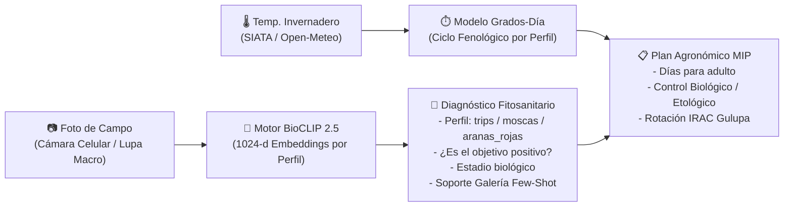

# 📚 Centro de Documentación — Macollo Visión Fitosanitaria API

Bienvenido a la documentación oficial del microservicio **Macollo Visión Fitosanitaria API** (`macollo-trips-api`), el motor de visión artificial, machine learning biológico y manejo agronómico para **Trips (*Thysanoptera: Thripidae*)**, **moscas de la fruta (*Anastrepha*)** y **arañas rojas (*Tetranychus urticae*)** en cultivos de **Gulupa (*Passiflora edulis f. edulis*)**.

> **Compatibilidad:** la API 2.x conserva los campos y carpetas de la versión 1.x
> de trips. Los perfiles `moscas` (Moscas de la Fruta) y `aranas_rojas`
> (Arañas Rojas) son estables y comparten el mismo motor genérico.

---

## 🗺️ Mapa de la Documentación

| Documento | Audiencia | Propósito y Contenido Principal |
| :--- | :--- | :--- |
| [🔌 Guía de Integración para Apps](./INTEGRATION_GUIDE.md) | Desarrolladores Frontend / Backend / Móvil | Guía completa paso a paso para conectar aplicaciones externas (React, Next.js, Node.js, Python, Flutter, cURL) a la API en Google Cloud Run con API Keys, payload `multipart/form-data`, manejo de cold starts y respuesta JSON. |
| [🏗️ Arquitectura](./ARCHITECTURE.md) | Arquitectos, Devs, ML Engineers | Design del sistema en capas, flujo de datos, pipeline de inferencia, integración BioCLIP 2.5 + k-NN Few-Shot y diagramas de componentes. |
| [🔌 Referencia de Endpoints](./ENDPOINTS.md) | Desarrolladores Frontend / Integradores | Catálogo exhaustivo de endpoints HTTP: predicción, autenticación, gestión de API keys, galería y fichas técnicas. Formatos, códigos HTTP y ejemplos con `curl` y `fetch`. |
| [🧠 Motor BioCLIP 2.5 & ML](./BIOCLIP-ML.md) | Machine Learning / Visión Artificial | Fundamentos del modelo `imageomics/bioclip-2.5-vith14`, espacio latente de 1024 dimensiones, prompts taxonómicos, discriminación de plagas y ensamble Few-Shot. |
| [🌿 Agronomía & Manejo MIP](./AGRONOMY-MIP.md) | Agrónomos, Asistentes Técnicos, Campo | Biología de *Frankliniella occidentalis* y *Thrips tabaci*, modelo térmico en grados-día ($T_0=10.5^\circ\text{C}$), prevención de roña/cacarizado para exportación GlobalG.A.P., control biológico y rotación IRAC. Incluye referencias a los proveedores de moscas de la fruta y arañas rojas. |
| [🔐 Autenticación & Seguridad](./AUTH.md) | Devs, DevOps, Seguridad | Sesiones de administrador con cookies firmadas HMAC-SHA256, API keys con prefijo `mk_` y hash SHA-256 en reposo, políticas CORS y prevención de fugas. |
| [📖 Diccionario de Datos](./DATA-DICTIONARY.md) | Devs, DBAs, Integradores | Modelos Pydantic, estructuras JSON de request/response, formatos de almacenamiento en disco (`api_keys.json`, `.auth_secret`, `gallery_embeddings.pt`). |
| [🚀 Despliegue & Operaciones](./DEPLOYMENT.md) | DevOps, Administradores de Sistemas | Guía de despliegue con Docker, servicio systemd, proxy inverso Nginx/Caddy con HTTPS/SSL (obligatorio para cámara WebRTC), variables de entorno y optimización de hilos CPU/GPU. |
| [🌐 Cloudflare Tunnel para prototipos](./CLOUDFLARE-TUNNEL.md) | Devs, QA, Integradores | Publicar la API por HTTPS en minutos sin abrir puertos, conectar otra página web, configurar CORS y probar los tres perfiles. |
| [📊 Diagramas de Secuencia](./SEQUENCE_DIAGRAMS.md) | Desarrolladores, Evaluadores | Flujos paso a paso en diagramas Mermaid: inferencia en tiempo real, reindexación de galería, autenticación/emisión de claves e integración con el portal web Macollo. |
| [🧩 Extender el Catálogo](./EXTENDING.md) | Devs, ML Engineers, Agrónomos | Cómo agregar moscas de la fruta, arañas rojas, perfiles y proveedores agronómicos sin tocar el motor de ML. Estructura de galería y calibración de umbrales. |
| [🧪 Guía de Pruebas (Testing)](./TESTING.md) | QA, Desarrolladores | Suite de pruebas automatizadas con `unittest`, cobertura de código, pruebas de estrés, casos de validación y protocolo de pruebas de campo. |
| [🛠️ Resolución de Problemas](./TROUBLESHOOTING.md) | Soporte, Operadores, Devs | Solución a problemas frecuentes: permisos de cámara WebRTC en móviles, fallos de descarga de pesos HuggingFace, saturación de memoria RAM, errores de API key. |
| [📱 Manual de Usuario de Campo](./USER_MANUAL.md) | Agrónomos de campo, Operarios | Guía práctica de uso de la Web App móvil: encuadre y zoom macro, registro de temperatura, interpretación de alertas de urgencia y enriquecimiento de la galería. |
| [🤝 Guía de Contribución](./CONTRIBUTING.md) | Equipo de Desarrollo | Estándares de código PEP 8, typing con mypy, flujo de Git, cómo agregar nuevas reglas MIP o nuevas clases taxonómicas. |
| [📝 Registro de Cambios (Changelog)](./CHANGELOG.md) | Todos | Historial detallado de versiones, mejoras, correcciones y refactorizaciones del microservicio. |

---

## 🎯 Resumen Ejecutivo del Servicio

El servicio `macollo-trips-api` resuelve tres necesidades críticas en la producción tecnificada de Gulupa de exportación:

1. **Tres Perfiles Fitosanitarios Estables**: `trips` (trips de las flores, pasifloras y cebolla), `moscas` (mosca de la fruta *Anastrepha*) y `aranas_rojas` (*Tetranychus urticae*). Cada perfil define sus propios objetivos positivos, clases confusoras y estadios.
2. **Identificación de Estadio Biológico**: Clasifica los estadios propios de cada perfil (huevo, larva/ninfa, pupa, adulto y daño) según el catálogo.
3. **Cálculo Térmico del Ciclo y Recomendaciones MIP**: A partir de la temperatura en tiempo real del invernadero, proyecta la evolución del ciclo y genera recomendaciones de control adaptadas al organismo detectado.
4. **Memoria Empírica Local (Few-Shot k-NN)**: Permite incorporar fotos reales del propio predio a `data/reference_gallery/` para calibrar la confianza mediante similitud de cosenos, sin reentrenar la red neuronal. La búsqueda está filtrada por perfil.

---

## 🔗 Enlaces Rápidos y Repositorios

- **Repositorio API**: [VoctorMCL/macollo-trips-api](https://github.com/VoctorMCL/macollo-trips-api)
- **Repositorio Plataforma Web Principal**: [VoctorMCL/Macollo](https://github.com/VoctorMCL/Macollo)
- **Documentación de la Plataforma Web**: [Macollo Docs](/home/victormcl/Documents/Macollo/docs/README.md)
- **Swagger / OpenAPI Interactivo**: `http://localhost:8000/docs`
- **Guía Rápida de Conexión Web**: [`GUIA_CONEXION_WEB.md`](../GUIA_CONEXION_WEB.md)
