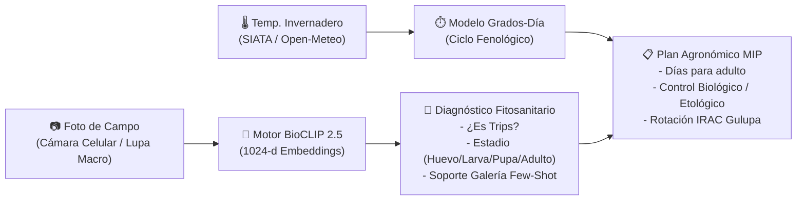

# 📚 Centro de Documentación — Trips BioCLIP 2.5 API para Gulupa

Bienvenido a la documentación oficial y completa del microservicio **Macollo Trips API** (`macollo-trips-api`), el motor de visión artificial, machine learning biológico y manejo agronómico especializado en **Trips (*Thysanoptera: Thripidae*)** para cultivos de **Gulupa (*Passiflora edulis f. edulis*)**.

---

## 🗺️ Mapa de la Documentación

| Documento | Audiencia | Propósito y Contenido Principal |
| :--- | :--- | :--- |
| [🏗️ Arquitectura](./ARCHITECTURE.md) | Arquitectos, Devs, ML Engineers | Diseño del sistema en capas, flujo de datos, pipeline de inferencia, integración BioCLIP 2.5 + k-NN Few-Shot y diagramas de componentes. |
| [🔌 Referencia de Endpoints](./ENDPOINTS.md) | Desarrolladores Frontend / Integradores | Catálogo exhaustivo de endpoints HTTP: predicción, autenticación, gestión de API keys, galería y fichas técnicas. Formatos, códigos HTTP y ejemplos con `curl` y `fetch`. |
| [🧠 Motor BioCLIP 2.5 & ML](./BIOCLIP-ML.md) | Machine Learning / Visión Artificial | Fundamentos del modelo `imageomics/bioclip-2.5-vith14`, espacio latente de 1024 dimensiones, prompts taxonómicos, discriminación de plagas y ensamble Few-Shot. |
| [🌿 Agronomía & Manejo MIP](./AGRONOMY-MIP.md) | Agrónomos, Asistentes Técnicos, Campo | Biología de *Frankliniella occidentalis* y *Thrips tabaci*, modelo térmico en grados-día ($T_0=10.5^\circ\text{C}$), prevención de roña/cacarizado para exportación GlobalG.A.P., control biológico y rotación IRAC. |
| [🔐 Autenticación & Seguridad](./AUTH.md) | Devs, DevOps, Seguridad | Sesiones de administrador con cookies firmadas HMAC-SHA256, API keys con prefijo `mk_` y hash SHA-256 en reposo, políticas CORS y prevención de fugas. |
| [📖 Diccionario de Datos](./DATA-DICTIONARY.md) | Devs, DBAs, Integradores | Modelos Pydantic, estructuras JSON de request/response, formatos de almacenamiento en disco (`api_keys.json`, `.auth_secret`, `gallery_embeddings.pt`). |
| [🚀 Despliegue & Operaciones](./DEPLOYMENT.md) | DevOps, Administradores de Sistemas | Guía de despliegue con Docker, servicio systemd, proxy inverso Nginx/Caddy con HTTPS/SSL (obligatorio para cámara WebRTC), variables de entorno y optimización de hilos CPU/GPU. |
| [📊 Diagramas de Secuencia](./SEQUENCE_DIAGRAMS.md) | Desarrolladores, Evaluadores | Flujos paso a paso en diagramas Mermaid: inferencia en tiempo real, reindexación de galería, autenticación/emisión de claves e integración con el portal web Macollo. |
| [🧪 Guía de Pruebas (Testing)](./TESTING.md) | QA, Desarrolladores | Suite de pruebas automatizadas con `unittest`, cobertura de código, pruebas de estrés, casos de validación y protocolo de pruebas de campo. |
| [🛠️ Resolución de Problemas](./TROUBLESHOOTING.md) | Soporte, Operadores, Devs | Solución a problemas frecuentes: permisos de cámara WebRTC en móviles, fallos de descarga de pesos HuggingFace, saturación de memoria RAM, errores de API key. |
| [📱 Manual de Usuario de Campo](./USER_MANUAL.md) | Agrónomos de campo, Operarios | Guía práctica de uso de la Web App móvil: encuadre y zoom macro, registro de temperatura, interpretación de alertas de urgencia y enriquecimiento de la galería. |
| [🤝 Guía de Contribución](./CONTRIBUTING.md) | Equipo de Desarrollo | Estándares de código PEP 8, typing con mypy, flujo de Git, cómo agregar nuevas reglas MIP o nuevas clases taxonómicas. |
| [📝 Registro de Cambios (Changelog)](./CHANGELOG.md) | Todos | Historial detallado de versiones, mejoras, correcciones y refactorizaciones del microservicio. |

---

## 🎯 Resumen Ejecutivo del Servicio

El servicio `macollo-trips-api` resuelve tres necesidades críticas en la producción tecnificada de Gulupa de exportación:

1. **Diagnóstico Taxonómico Preciso**: Discrimina trips verdaderos (*Frankliniella occidentalis*, *Thrips tabaci*, *Frankliniella panamensis*) frente a plagas confusoras frecuentes en pasifloráceas (mosca blanca *Bemisia tabaci*, pulgón *Aphis gossypii*, arañita roja *Tetranychus urticae*, ácaro plano *Brevipalpus*) y vegetación sana.
2. **Identificación de Estadio Biológico**: Clasifica las 4 fases biológicas reales (**Huevo**, **Larva/Ninfa**, **Pupa/Prepupa** y **Adulto**) más la manifestación visible de **Daño (Roña/Cacarizado)**.
3. **Cálculo Térmico del Ciclo y Recomendaciones MIP**: A partir de la temperatura en tiempo real del invernadero, proyecta los días restantes hasta la emergencia masiva de adultos y genera recomendaciones de control biológico (*Amblyseius swirskii*, *Orius insidiosus*), trampas cromotrópicas azules (~460 nm) y rotación obligatoria IRAC para salvaguardar la fruta de exportación (GlobalG.A.P.).
4. **Memoria Empírica Local (Few-Shot k-NN)**: Permite incorporar fotos reales tomadas en el propio predio a `data/reference_gallery/` para calibrar la confianza mediante similitud de cosenos sin necesidad de reentrenar la red neuronal.

---

## 🔗 Enlaces Rápidos y Repositorios

- **Repositorio API**: [VoctorMCL/macollo-trips-api](https://github.com/VoctorMCL/macollo-trips-api)
- **Repositorio Plataforma Web Principal**: [VoctorMCL/Macollo](https://github.com/VoctorMCL/Macollo)
- **Documentación de la Plataforma Web**: [Macollo Docs](/home/victormcl/Documents/Macollo/docs/README.md)
- **Swagger / OpenAPI Interactivo**: `http://localhost:8000/docs`
- **Guía Rápida de Conexión Web**: [`GUIA_CONEXION_WEB.md`](../GUIA_CONEXION_WEB.md)
