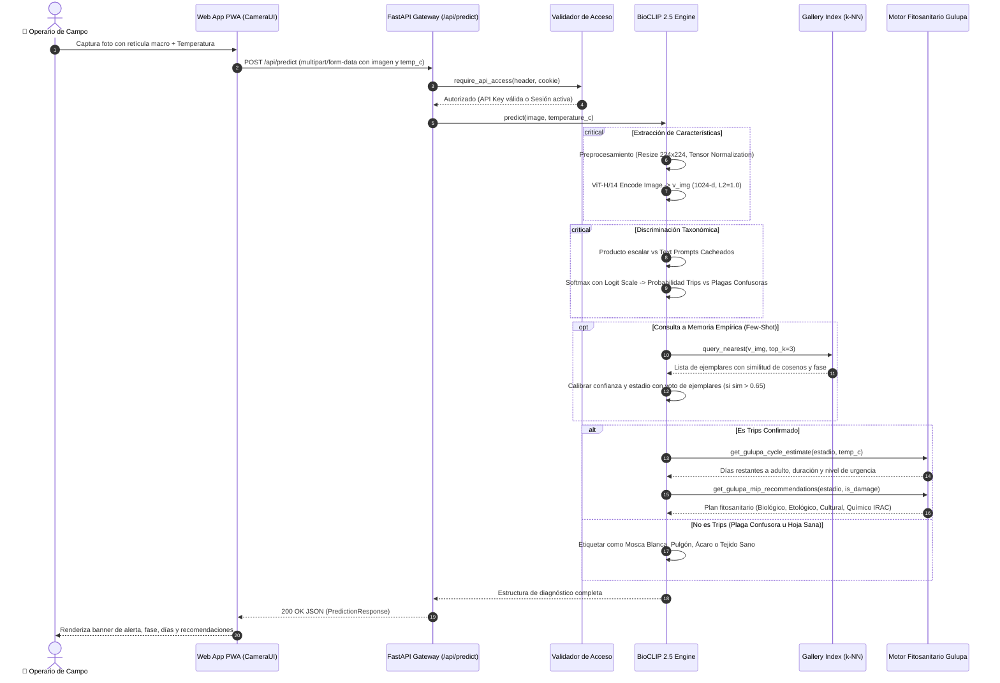
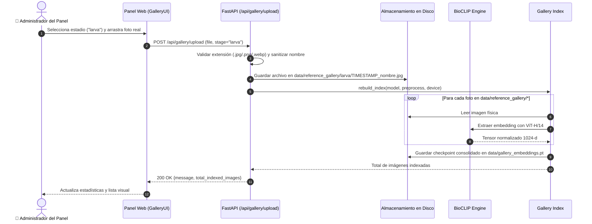
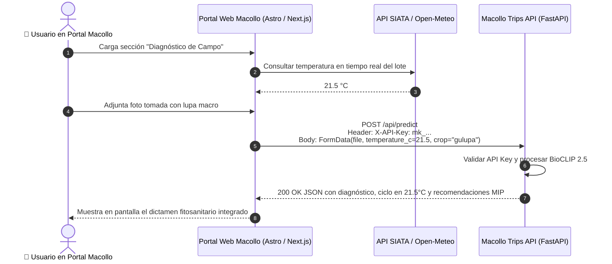

# 📊 Diagramas de Secuencia — Trips BioCLIP 2.5 API

Este documento presenta los flujos de interacción temporal entre los componentes del sistema mediante diagramas Mermaid estructurados.

---

## 1. Flujo de Inferencia Fitosanitaria en Tiempo Real

Ilustra la recepción de una foto de campo desde la cámara móvil, la autenticación, la proyección en el espacio latente de BioCLIP 2.5, la búsqueda de vecinos cercanos y la generación del dictamen agronómico.



---

## 2. Flujo de Subida y Reindexación Vectorial de la Galería

Muestra cómo una nueva fotografía aportada por el usuario enriquece la memoria del modelo sin necesidad de reentrenamiento.



---

## 3. Flujo de Inicio de Sesión y Emisión de API Keys

Muestra el protocolo de login sin registro público y la generación segura de tokens de cliente con hash SHA-256.

```mermaid
sequenceDiagram
    autonumber
    actor Admin as 👤 Administrador
    participant UI as Panel Web
    participant Auth as Módulo de Seguridad (auth.py)
    participant DB as data/api_keys.json

    Admin->>UI: Ingresa usuario y contraseña configurados en servidor
    UI->>Auth: POST /api/auth/login {username, password}
    Auth->>Auth: Validar credenciales con hmac.compare_digest()
    Auth->>Auth: Generar token de sesión firmado con HMAC-SHA256
    Auth-->>UI: Set-Cookie: macollo_session=<token>; HttpOnly; SameSite=Lax
    
    Note over Admin, UI: Administrador dentro del Panel (Sesión Activa)

    Admin->>UI: Ingresa nombre ("Portal Macollo") y presiona "Crear clave"
    UI->>Auth: POST /api/keys {name: "Portal Macollo"} (con Cookie)
    Auth->>Auth: Generar token aleatorio: raw_key = "mk_" + secrets.token_urlsafe(32)
    Auth->>Auth: key_hash = sha256(raw_key), prefix = raw_key[:12]
    Auth->>DB: Guardar {id, name, prefix, key_hash, created_at, active: true}
    Auth-->>UI: 200 OK {raw_key, key_metadata}
    UI-->>Admin: ⚠️ Muestra raw_key completa UNA SOLA VEZ para que la copie
```

---

## 4. Integración Externa: Plataforma Web Macollo llamando a la API

Ilustra la integración con una página web existente (ej. portal [Macollo](https://github.com/VoctorMCL/Macollo) en Astro/React) consumiendo predicciones y coordinando datos meteorológicos de SIATA o Open-Meteo.


