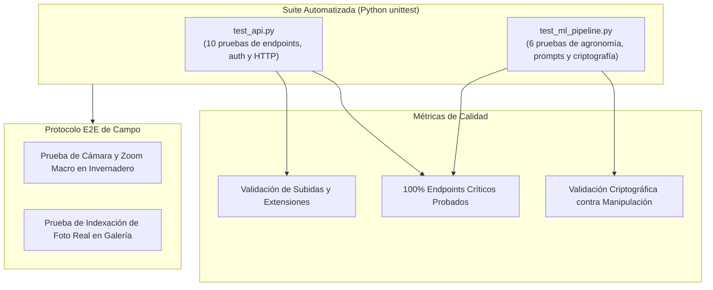

# 🧪 Guía de Pruebas (Testing) — Trips BioCLIP 2.5 API

Este documento detalla la estrategia de aseguramiento de calidad (QA), el catálogo de pruebas unitarias y de integración automatizadas, y el protocolo de validación de campo para **Macollo Trips API**.

---

## 1. Estrategia de Pruebas

El sistema combina pruebas automatizadas a nivel de unidad y API con un protocolo de verificación manual en campo:



---

## 2. Catálogo de Pruebas Automatizadas (16 Casos)

### 2.1 Módulo `test_api.py` (Endpoints y Seguridad HTTP)
1. **`test_health_check`**: Comprueba que `GET /api/health` responda HTTP 200 con estado `"healthy"`, información del modelo y estadísticas de galería.
2. **`test_auth_required_for_gallery`**: Verifica que las rutas privadas de galería respondan HTTP 401 si no hay sesión iniciada ni API key.
3. **`test_login_and_session`**: Valida el flujo completo de login con credenciales correctas e incorrectas, emisión de la cookie y verificación en `GET /api/auth/me`.
4. **`test_gallery_endpoints`**: Confirma que un usuario autenticado pueda consultar las estadísticas de fotos y listar archivos indexados.
5. **`test_api_key_management`**: Ciclo de vida completo de una API key:
   - Creación con generación de clave única con prefijo `mk_`.
   - Consulta en la lista pública de claves.
   - Autorización exitosa de endpoints con `X-API-Key`.
   - Revocación desde el panel y bloqueo subsiguiente (HTTP 401).
6. **`test_gulupa_handbook_endpoint`**: Verifica que la ficha agronómica de Gulupa devuelva información fenológica y recomendaciones para la temperatura solicitada.
7. **`test_predict_requires_auth`**: Garantiza que `POST /api/predict` rechace peticiones anónimas sin API key.
8. **`test_predict_validates_image_content_type`**: Verifica que el envío de archivos de texto o no-imagen sea rechazado con HTTP 400 Bad Request.
9. **`test_gallery_upload_validations`**: Comprueba que la subida a galería rechace estadios inexistentes y extensiones no permitidas (ej. `.exe`).
10. **`test_logout`**: Verifica que `POST /api/auth/logout` limpie la cookie y cierre la sesión de forma inmediata.

### 2.2 Módulo `test_ml_pipeline.py` (Agronomía, Taxonomía y Criptografía)
11. **`test_taxonomy_prompts_integrity`**: Valida que los 14 prompts taxonómicos estén definidos, que existan las 4 fases biológicas reales (`huevo`, `larva`, `pupa`, `adulto`) y que no existan fases de ninfa divididas erróneamente (`ninfa_1`, `ninfa_2`).
12. **`test_thermal_cycle_calculation`**: Verifica la disminución fisiológica de los días de desarrollo al aumentar la temperatura ambiental (ej. $15^\circ\text{C}$ vs $25^\circ\text{C}$) según las ecuaciones de grados-día.
13. **`test_mip_recommendations`**: Comprueba que el plan agronómico contenga los 5 ejes obligatorios: control biológico (*Amblyseius swirskii* u *Orius*), etológico (trampas azules), cultural, químico/biorracional y alerta de exportación.
14. **`test_mip_damage_manifestation_handling`**: Valida que ante manifestaciones de daño visible (`is_damage_only=True` o `dano_gulupa`) se incluyan recomendaciones específicas de clasificación de cacarizado y protección de la siguiente cohorte de flores.
15. **`test_auth_token_tampering`**: Prueba de ataque criptográfico: valida que un token alterado, truncado o sin firma válida sea inmediatamente rechazado (`None`).
16. **`test_gallery_manager_initialization`**: Comprueba que el gestor de fotos de referencia inicialice la estructura de carpetas y reporte el desglose de imágenes.

---

## 3. Ejecución de las Pruebas

Para ejecutar la suite completa utilizando el intérprete del entorno virtual:

```bash
# Ejecutar todas las pruebas
.venv/bin/python -m unittest discover backend/tests

# Ejecutar con salida detallada (verbose)
.venv/bin/python -m unittest -v backend/tests/test_api.py
.venv/bin/python -m unittest -v backend/tests/test_ml_pipeline.py
```

### Salida Esperada:
```text
Ran 16 tests in 0.080s

OK
```

### Medición de Cobertura de Código:
```bash
.venv/bin/python -m pip install coverage
.venv/bin/python -m coverage run -m unittest discover backend/tests
.venv/bin/python -m coverage report -m
```

---

## 4. Protocolo de Pruebas de Campo en Invernadero (E2E)

Antes de validar una versión candidata en producción, el agrónomo o técnico debe ejecutar el siguiente protocolo manual en una tableta o celular:

1. **Prueba de Conexión y Cámara**:
   - Abrir `https://<IP-O-DOMINIO>:8000`.
   - Iniciar sesión con `admin`.
   - Comprobar que el video de la cámara trasera se inicie fluidamente con la retícula macro visible.
   - Mover el control deslizante de **Zoom Macro** de $1.0\times$ a $2.5\times$ y confirmar que el recorte central se aplique correctamente.
2. **Prueba de Diagnóstico con Hoja Sana**:
   - Apuntar la cámara a una hoja verde limpia sin plagas.
   - Presionar **"Capturar y Analizar"**.
   - Resultado esperado: Banner verde `"No corresponde a trips"` e indicación `"Sin infestación de trips"`.
3. **Prueba de Diagnóstico con Daño en Fruto (Roña)**:
   - Apuntar la cámara a un fruto verde con cicatriz corchosa.
   - Ajustar la temperatura en la barra superior a la lectura del sensor (ej. $21^\circ\text{C}$).
   - Presionar **"Capturar y Analizar"**.
   - Resultado esperado: Alerta roja `"Trips detectado"`, fase `"Manifestación de Daño (Roña / Cacarizado)"` y sección de recomendaciones MIP desplegada con alerta de exportación.
4. **Prueba de Calibración de Galería**:
   - Ir a la pestaña **Galería**.
   - Seleccionar fase `"larva"` y subir una foto macro de buena calidad.
   - Comprobar el mensaje de confirmación y el incremento en el contador de fotos indexadas.
