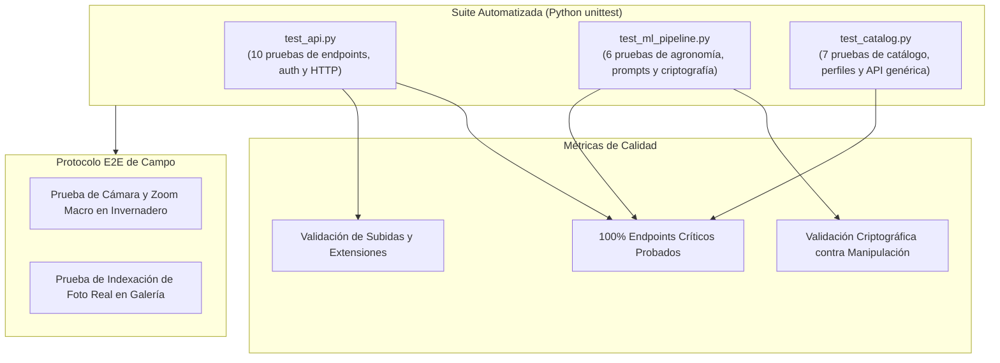

# 🧪 Guía de Pruebas (Testing) — Macollo Visión Fitosanitaria API

Este documento detalla la estrategia de aseguramiento de calidad (QA), el catálogo de pruebas unitarias y de integración automatizadas, y el protocolo de validación de campo para **Macollo Visión Fitosanitaria API**.

---

## 1. Estrategia de Pruebas

El sistema combina pruebas automatizadas a nivel de unidad y API con un protocolo de verificación manual en campo:



---

## 2. Catálogo de Pruebas Automatizadas (23 Casos)

### 2.1 Módulo `test_api.py` (Endpoints y Seguridad HTTP)
1. **`test_health_check`**: Comprueba que `GET /api/health` responda HTTP 200 con estado `"healthy"`, información del modelo y estadísticas de galería.
2. **`test_auth_required_for_gallery`**: Verifica que las rutas privadas de galería respondan HTTP 401 si no hay sesión iniciada ni API key.
3. **`test_login_and_session`**: Valida el flujo completo de login con credenciales correctas e incorrectas, emisión de la cookie y verificación en `GET /api/auth/me`.
4. **`test_gallery_endpoints`**: Confirma que un usuario autenticado pueda consultar las estadísticas de fotos y listar archivos indexados.
5. **`test_api_key_management`**: Ciclo de vida completo de una API key:
   - Creación con generación de clave única con prefijo `mk_`.
   - Consulta autenticada en la lista de claves del panel.
   - Autorización exitosa de endpoints con `X-API-Key`.
   - Revocación desde el panel y bloqueo subsiguiente (HTTP 401).
6. **`test_gulupa_handbook_endpoint`**: Verifica que la ficha agronómica de Gulupa devuelva información fenológica y recomendaciones para la temperatura solicitada.
7. **`test_predict_requires_auth`**: Garantiza que `POST /api/predict` rechace peticiones anónimas sin API key.
8. **`test_predict_validates_image_content_type`**: Verifica que el envío de archivos de texto o no-imagen sea rechazado con HTTP 400 Bad Request.
9. **`test_gallery_upload_validations`**: Comprueba que la subida a galería rechace estadios inexistentes y extensiones no permitidas (ej. `.exe`).
10. **`test_logout`**: Verifica que `POST /api/auth/logout` limpie la cookie y cierre la sesión de forma inmediata.

### 2.2 Módulo `test_ml_pipeline.py` (Agronomía, Taxonomía y Criptografía)
11. **`test_taxonomy_prompts_integrity`**: Valida que cada perfil del catálogo tenga prompts para todos sus objetivos y estadios, que existan las fases biológicas reales (`huevo`, `larva`, `pupa`, `adulto`) y que no existan fases de ninfa duplicadas o mal divididas (`ninfa_1`, `ninfa_2`).
12. **`test_thermal_cycle_calculation`**: Verifica la disminución fisiológica de los días de desarrollo al aumentar la temperatura ambiental (ej. $15^\circ\text{C}$ vs $25^\circ\text{C}$) según las ecuaciones de grados-día.
13. **`test_mip_recommendations`**: Comprueba que el plan agronómico contenga los 5 ejes obligatorios: control biológico (*Amblyseius swirskii* u *Orius*), etológico (trampas azules), cultural, químico/biorracional y alerta de exportación.
14. **`test_mip_damage_manifestation_handling`**: Valida que ante manifestaciones de daño visible (`is_damage_only=True` o `dano_gulupa`) se incluyan recomendaciones específicas de clasificación de cacarizado y protección de la siguiente cohorte de flores.
15. **`test_auth_token_tampering`**: Prueba de ataque criptográfico: valida que un token alterado, truncado o sin firma válida sea inmediatamente rechazado (`None`).
16. **`test_gallery_manager_initialization`**: Comprueba que el gestor de fotos de referencia inicialice la estructura de carpetas y reporte el desglose de imágenes.

### 2.3 Módulo `test_catalog.py` (Catálogo Extensible y API Genérica)
17. **`test_profiles_and_targets_integrity`**: Valida que cada perfil tenga objetivos y estadios coherentes, umbrales válidos y clases positivas registradas.
18. **`test_legacy_and_generic_gallery_labels`**: Confirma que se conservan las carpetas históricas de trips y se generan las de `moscas` y `aranas_rojas` como `perfil/objetivo/estadio`.
19. **`test_generic_agronomy_providers`**: Verifica que los proveedores de moscas de la fruta y arañas rojas devuelvan ciclo y recomendaciones completas.
20. **`test_profile_lookup_errors`**: Comprueba que un perfil inexistente lance un `KeyError` con un mensaje útil.
21. **`test_catalog_and_profiles_endpoints`**: Valida `GET /api/catalog` y `GET /api/profiles` sin autenticación.
22. **`test_gallery_labels_endpoint`**: Verifica que `GET /api/gallery/labels` agrupe las etiquetas por perfil.
23. **`test_generic_handbook_endpoint`**: Comprueba que `GET /api/handbook?profile=...` devuelva la ficha genérica para cualquier perfil.

---

## 3. Ejecución de las Pruebas

Para ejecutar la suite completa utilizando el intérprete del entorno virtual:

```bash
# Ejecutar todas las pruebas
.venv/bin/python -m unittest discover -s backend/tests

# Ejecutar con salida detallada (verbose)
.venv/bin/python -m unittest -v backend/tests/test_api.py
.venv/bin/python -m unittest -v backend/tests/test_ml_pipeline.py
.venv/bin/python -m unittest -v backend/tests/test_catalog.py
```

### Salida Esperada:
```text
Ran 23 tests in 0.277s

OK
```

### Medición de Cobertura de Código:
```bash
.venv/bin/python -m pip install coverage
.venv/bin/python -m coverage run -m unittest discover backend/tests
.venv/bin/python -m coverage report -m
```

---

## 4. Protocolo de Pruebas de Campo en Invernadero (E2E)

Antes de validar una versión candidata en producción, el agrónomo o técnico debe ejecutar el siguiente protocolo manual en una tableta o celular:

1. **Prueba de Conexión y Cámara**:
   - Abrir `https://<IP-O-DOMINIO>:8000`.
   - Iniciar sesión con `admin`.
   - Comprobar que el video de la cámara trasera se inicie fluidamente con la retícula macro visible.
   - Mover el control deslizante de **Zoom Macro** de $1.0\times$ a $2.5\times$ y confirmar que el recorte central se aplique correctamente.
2. **Prueba de Diagnóstico con Hoja Sana (los tres perfiles)**:
   - Apuntar la cámara a una hoja verde limpia sin plagas.
   - Repetir la captura con los perfiles `trips`, `moscas` y `aranas_rojas`.
   - Resultado esperado: banner verde `"No corresponde al objetivo"` con categoría `healthy` o una clase confusora, y `detection.is_positive = false`.
3. **Prueba de Diagnóstico con Daño en Fruto (Roña)**:
   - Seleccionar el perfil `trips` y apuntar la cámara a un fruto verde con cicatriz corchosa.
   - Ajustar la temperatura en la barra superior a la lectura del sensor (ej. $21^\circ\text{C}$).
   - Presionar **"Capturar y Analizar"**.
   - Resultado esperado: alerta roja `"Objetivo detectado"`, estadio de daño (`dano_gulupa`) y recomendaciones MIP desplegadas con alerta de exportación.
4. **Prueba de Diagnóstico de Mosca de la Fruta y Araña Roja**:
   - Seleccionar `moscas` y capturar un fruto con picadura o una trampa con adultos de *Anastrepha*; verificar el estadio y el plan MIP.
   - Seleccionar `aranas_rojas` y capturar el envés de una hoja con punteado o telaraña; verificar el estadio `dano` y el plan MIP.
5. **Prueba de Calibración de Galería por Perfil**:
   - Ir a la pestaña **Galería** y elegir el perfil, el objetivo y el estadio.
   - Subir una foto macro de buena calidad.
   - Comprobar el mensaje de confirmación, la carpeta `label` usada y el incremento en el contador de fotos indexadas.
   - Verificar que la predicción de otro perfil no mezcle esos ejemplares (`exemplar_matches` filtrado por perfil).
