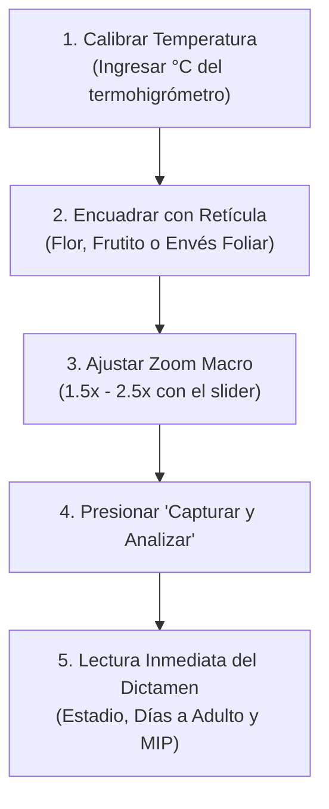

# 📱 Manual de Usuario de Campo — Trips BioCLIP 2.5 Web App

Este manual está dirigido a **agrónomos, asistentes técnicos y operarios de campo** que realizan labores de monitoreo fitosanitario en cultivos protegidos e invernaderos de **Gulupa (*Passiflora edulis f. edulis*)**.

---

## 1. Acceso a la Aplicación Web Móvil

1. Abre el navegador web de tu celular o tableta (Google Chrome o Safari recomendados).
2. Ingresa la dirección del servidor suministrada por el administrador de la finca:
   - Ejemplo local: `http://192.168.1.50:8000`
   - Ejemplo en nube: `https://trips.tu-finca.com`
3. En la pantalla de bienvenida, ingresa tus credenciales de acceso:
   - **Usuario**: `admin` (o tu usuario asignado)
   - **Contraseña**: La contraseña configurada en el servidor.
4. Presiona **"Entrar"**.

---

## 2. Pestaña 1: Inspección de Campo (Diagnóstico con Cámara)

Esta es la herramienta principal de trabajo diario entre las espalderas del cultivo.

### 2.1 Calibración de la Temperatura
En la barra superior encontrarás el selector de **Temperatura del Invernadero**:
- Por defecto marca `20.0 °C`.
- Modifícalo según la lectura actual de tu termohigrómetro de campo o la estación meteorológica más cercana (ej. SIATA u Open-Meteo).
- **¿Por qué es importante?** La temperatura determina a qué velocidad se reproducen los insectos. Un aumento de $18^\circ\text{C}$ a $25^\circ\text{C}$ reduce a la mitad el tiempo en que las larvas dañinas se convierten en adultos voladores.

### 2.2 Encuadre y Zoom Macro
- La cámara trasera del dispositivo se activará automáticamente mostrando una **retícula central verde**.
- Acerca el lente del teléfono a unos 10 a 15 cm de la flor, brote o frutito.
- Mueve el control deslizante **Zoom Macro** hacia la derecha (ej. $1.5\times$ a $2.5\times$) para ampliar visualmente los insectos sin perder nitidez.
- Si la luz solar es muy intensa o estás bajo una malla sombra oscura, busca un ángulo donde no generes sombra directa con tu cuerpo.

### 2.3 Captura y Diagnóstico
- Presiona el botón verde grande **"Capturar y Analizar"**.
- La imagen se congelará y el sistema tardará menos de 1 segundo en emitir el diagnóstico.
- *(Alternativa)* Si ya tomaste una foto previa con una lupa acoplable de alta magnificación, presiona el botón de galería (ícono de imagen) para subirla directamente desde la memoria del celular.

---

## 3. Cómo Interpretar los Resultados

Al completarse el análisis, la tarjeta de diagnóstico se desplazará automáticamente:

### 3.1 Banner de Alerta Fitosanitaria
- 🔴 **Rojo ("Trips detectado")**: Se confirmó la presencia de trips o lesiones activas de alimentación.
- 🟢 **Verde ("No corresponde a trips")**: La muestra analizada corresponde a una hoja o flor sana, o a una plaga secundaria (mosca blanca, pulgón, arañita roja) que no pertenece a la familia Thripidae.

### 3.2 Estadio Biológico Detectado
Si se detecta trips, el sistema especificará en cuál de las 4 fases biológicas se encuentra:
- **Huevo**: Insertado en el tejido vegetal. Aún no hay daño directo, pero la eclosión es inminente.
- **Larva / Ninfa (Raspado)**: **FASE CRÍTICA**. Es el estadio voraz que causa el "cacarizado" o "roña" en frutos pequeños (< 3 cm). Requiere intervención foliar inmediata.
- **Prepupa / Pupa**: Insecto en reposo refugiado en la base de la planta, hojarasca o espaldera. Indica que en pocos días emergerán nuevos adultos voladores.
- **Adulto**: Insecto con alas plumosas en fase de dispersión, cópula y oviposición en botones florales.
- **Manifestación de Daño (Roña/Cacarizado)**: Lesión corchosa visible en fruto o flor.

### 3.3 Estimación Térmica (Días para Adulto)
El sistema calcula los días exactos que restan para que la población observada complete su desarrollo a la temperatura registrada. Por ejemplo:
> *"5.0 días restantes para alcanzar fase adulta tras eclosión a 21.5°C — Nivel de urgencia: CRÍTICO"*.

### 3.4 Medidas de Manejo Integrado de Plagas (MIP)
En la parte inferior se despliegan acciones concretas y validadas para Gulupa:
- **Control Biológico**: Liberación recomendada de ácaros benéficos (*Amblyseius swirskii*), chinches piratas (*Orius*) o aspersión de *Beauveria bassiana*.
- **Control Etológico**: Ubicación y densidad de trampas cromotrópicas **azules** (~460 nm).
- **Control Cultural**: Podas en espaldera y ventilación para regular humedad relativa.
- **Control Químico/Biorracional**: Opciones autorizadas con pauta de rotación **IRAC** (IRAC 5 $\rightarrow$ IRAC 29 $\rightarrow$ IRAC 6) para no generar resistencia.
- **Alerta de Exportación GlobalG.A.P.**: Recomendaciones para evitar que la fruta sea descartada de las cajas tipo exportación a Europa.

---

## 4. Pestaña 2: Galería de Referencia (Memoria de tu Predio)

Permite aportar fotos reales tomadas en tu propia finca para calibrar y reforzar la precisión de BioCLIP 2.5:

1. Toca la pestaña **"Galería"** en la barra superior.
2. Selecciona la fase biológica correspondiente en el menú desplegable (`Huevo`, `Larva`, `Pupa`, `Adulto` o `Daño en Fruto`).
3. Arrastra una foto al recuadro o presiona sobre él para seleccionarla del carrete de fotos.
4. El sistema guardará la imagen en el servidor y recalculará su vector de características al instante.
5. Si copiaste imágenes masivamente desde tu computadora a la carpeta `data/reference_gallery/`, presiona el botón **"Reindexar Fotos Locales"** para que el modelo las aprenda.

---

## 5. Pestaña 3: API y Accesos

Diseñada para conectar otras aplicaciones o el portal web principal:

1. Presiona la pestaña **"API y accesos"**.
2. En el campo *"Nombre o aplicación"*, escribe un identificador (ej. *"Tablet Lote 3"* o *"Servidor Macollo"*).
3. Presiona **"Crear API Key"**.
4. **¡Atención!**: La clave completa (`mk_...`) aparecerá en una caja azul resaltada. Cópiala inmediatamente con el botón **"Copiar"**, ya que por razones de seguridad nunca más volverá a mostrarse en pantalla.
5. Puedes revocar cualquier clave en desuso o extraviada con el botón rojo **"Revocar"**.

---

## 6. Pestaña 4: Ficha Técnica

Contiene el resumen botánico de la Gulupa (*Passiflora edulis*), las especies de trips más dañinas y las directrices para el monitoreo en campo de botones florales.
