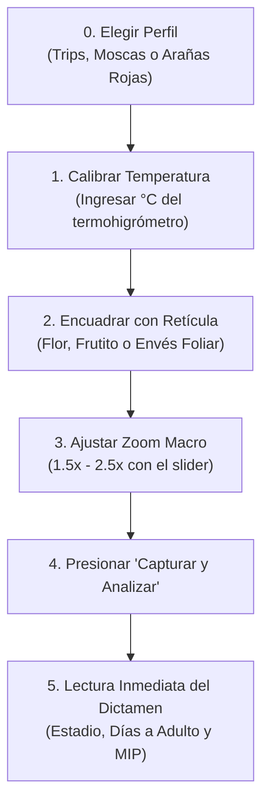

# 📱 Manual de Usuario de Campo — Macollo Visión Fitosanitaria

Este manual está dirigido a **agrónomos, asistentes técnicos y operarios de campo** que realizan labores de monitoreo fitosanitario en cultivos protegidos e invernaderos de **Gulupa (*Passiflora edulis f. edulis*)**. La aplicación permite diagnosticar tres perfiles: **Trips**, **Moscas de la Fruta** y **Arañas Rojas**.

---

## 1. Acceso a la Aplicación Web Móvil

1. Abre el navegador web de tu celular o tableta (Google Chrome o Safari recomendados).
2. Ingresa la dirección del servidor suministrada por el administrador de la finca:
   - Ejemplo local: `http://192.168.1.50:8000`
   - Ejemplo en nube: `https://trips.tu-finca.com`
3. En la pantalla de bienvenida, ingresa tus credenciales de acceso:
   - **Usuario**: `admin` (o tu usuario asignado)
   - **Contraseña**: La contraseña configurada en el servidor.
4. Presiona **"Entrar"**.

---

## 2. Pestaña 1: Inspección de Campo (Diagnóstico con Cámara)

Esta es la herramienta principal de trabajo diario entre las espalderas del cultivo.

### 2.0 Selección del Perfil de Detección
En la barra superior elige el perfil según el organismo que estás monitoreando:
- **Trips**: trips de las flores, de las pasifloras y de la cebolla, además del daño (roña/cacarizado).
- **Moscas de la Fruta**: *Anastrepha* spp., sus estadios y el daño en fruto.
- **Arañas Rojas**: *Tetranychus urticae*, sus estadios y el daño por punteado y telaraña.

El perfil cambia las clases que el modelo compara y el plan MIP que recibirás.

### 2.1 Calibración de la Temperatura
En la barra superior encontrarás el selector de **Temperatura del Invernadero**:
- Por defecto marca `20.0 °C`.
- Modifícalo según la lectura actual de tu termohigrómetro de campo o la estación meteorológica más cercana (ej. SIATA u Open-Meteo).
- **¿Por qué es importante?** La temperatura determina a qué velocidad se reproducen los insectos. Un aumento de $18^\circ\text{C}$ a $25^\circ\text{C}$ reduce a la mitad el tiempo en que las larvas dañinas se convierten en adultos voladores.

### 2.2 Encuadre y Zoom Macro
- La cámara trasera del dispositivo se activará automáticamente mostrando una **retícula central verde**.
- Acerca el lente del teléfono a unos 10 a 15 cm de la flor, brote o frutito.
- Mueve el control deslizante **Zoom Macro** hacia la derecha (ej. $1.5\times$ a $2.5\times$) para ampliar visualmente los insectos sin perder nitidez.
- Si la luz solar es muy intensa o estás bajo una malla sombra oscura, busca un ángulo donde no generes sombra directa con tu cuerpo.

### 2.3 Captura y Diagnóstico
- Presiona el botón verde grande **"Capturar y Analizar"**.
- La imagen se congelará y el sistema tardará menos de 1 segundo en emitir el diagnóstico.
- *(Alternativa)* Si ya tomaste una foto previa con una lupa acoplable de alta magnificación, presiona el botón de galería (ícono de imagen) para subirla directamente desde la memoria del celular.

---

## 3. Cómo Interpretar los Resultados

Al completarse el análisis, la tarjeta de diagnóstico se desplazará automáticamente:

### 3.1 Banner de Alerta Fitosanitaria
- 🔴 **Rojo ("Objetivo detectado")**: Se confirmó el organismo positivo del perfil seleccionado (trips, mosca de la fruta o araña roja).
- 🟡 **Amarillo ("Resultado incierto")**: La confianza está cerca del umbral de decisión. Repite la foto con mejor luz y mayor acercamiento.
- 🟢 **Verde ("No corresponde al objetivo")**: La muestra es tejido sano o una clase confusora (por ejemplo, mosca blanca, pulgón, ácaro plano o mosca minadora).

### 3.2 Estadio Biológico Detectado
Si se confirma el objetivo, el sistema especifica la fase biológica del perfil:

**Perfil Trips**
- **Huevo**: Insertado en el tejido vegetal. Aún no hay daño directo, pero la eclosión es inminente.
- **Larva / Ninfa (Raspado)**: **FASE CRÍTICA**. Es el estadio voraz que causa el "cacarizado" o "roña" en frutos pequeños (< 3 cm).
- **Prepupa / Pupa**: Insecto en reposo refugiado en la base de la planta, hojarasca o espaldera.
- **Adulto**: Insecto con alas plumosas en fase de dispersión, cópula y oviposición.
- **Daño (Roña/Cacarizado)**: Lesión corchosa visible en fruto o flor.

**Perfil Moscas de la Fruta**
- **Huevo**: Insertado bajo la epidermis del fruto.
- **Larva (Maggot)**: Larva blanca apoda que se alimenta de la pulpa.
- **Pupa (Pupario)**: Pupario parduzco en el suelo o en frutos caídos.
- **Adulto**: Mosca con alas bandeadas y ovipositor visible.
- **Daño**: Picadura de oviposición, pudrición y larvas dentro del fruto.

**Perfil Arañas Rojas**
- **Huevo**: Esféricos y translúcidos junto a la nervadura.
- **Ninfa (Larva)**: Móvil, más pequeña que el adulto.
- **Adulto**: Ocho patas, rojo o verdoso, con dos manchas oscuras.
- **Daño**: Punteado clorótico, bronceado y telaraña fina en el envés.

### 3.3 Estimación Térmica (Días para Adulto)
El sistema calcula los días exactos que restan para que la población observada complete su desarrollo a la temperatura registrada. Por ejemplo:
> *"5.0 días restantes para alcanzar fase adulta tras eclosión a 21.5°C — Nivel de urgencia: CRÍTICO"*.

### 3.4 Medidas de Manejo Integrado de Plagas (MIP)
En la parte inferior se despliegan acciones concretas y validadas para Gulupa, adaptadas al perfil seleccionado:
- **Control Biológico**: Enemigos naturales y bioinsumos específicos del organismo detectado.
- **Control Etológico**: Trampas, atrayentes y densidad recomendada según la plaga.
- **Control Cultural**: Podas, ventilación, manejo de humedad y erradicación de reservorios.
- **Control Químico/Biorracional**: Opciones autorizadas con pauta de rotación **IRAC** para no generar resistencia.
- **Alerta de Exportación GlobalG.A.P.**: Recomendaciones para evitar que la fruta sea descartada de las cajas tipo exportación a Europa.

---

## 4. Pestaña 2: Galería de Referencia (Memoria de tu Predio)

Permite aportar fotos reales tomadas en tu propia finca para calibrar y reforzar la precisión de BioCLIP 2.5:

1. Toca la pestaña **"Galería"** en la barra superior.
2. Elige el **perfil** (`Trips`, `Moscas de la Fruta` o `Arañas Rojas`), el **objetivo** y el **estadio** correspondiente en los selectores.
3. Arrastra una foto al recuadro o presiona sobre él para seleccionarla del carrete de fotos.
4. El sistema guardará la imagen en la carpeta del perfil y recalculará su vector de características al instante.
5. Si copiaste imágenes masivamente desde tu computadora a `data/reference_gallery/`, presiona el botón **"Reindexar Fotos Locales"** para que el modelo las aprenda.

> Las fotos de un perfil no se mezclan con las de otro: la búsqueda de referencia
> está filtrada por perfil. Sube cada muestra en la categoría correcta.

---

## 5. Pestaña 3: API y Accesos

Diseñada para conectar otras aplicaciones o el portal web principal:

1. Presiona la pestaña **"API y accesos"**.
2. En el campo *"Nombre o aplicación"*, escribe un identificador (ej. *"Tablet Lote 3"* o *"Servidor Macollo"*).
3. Presiona **"Crear API Key"**.
4. **¡Atención!**: La clave completa (`mk_...`) aparecerá en una caja azul resaltada. Cópiala inmediatamente con el botón **"Copiar"**, ya que por razones de seguridad nunca más volverá a mostrarse en pantalla.
5. Puedes revocar cualquier clave en desuso o extraviada con el botón rojo **"Revocar"**.

---

## 6. Pestaña 4: Ficha Técnica

Contiene la ficha de cada perfil: resumen del cultivo de Gulupa (*Passiflora edulis*), especies objetivo, ciclo biológico y directrices de monitoreo en campo. Puedes cambiar de perfil desde el selector superior de la ficha.
